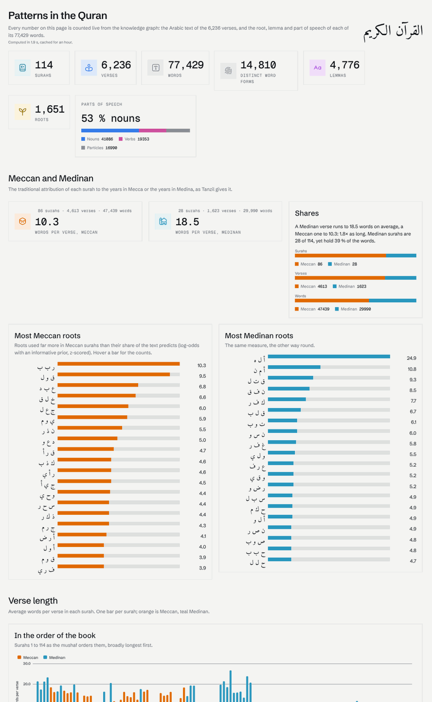
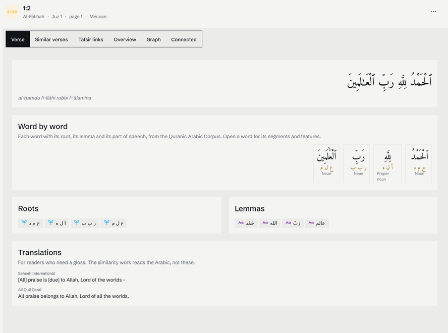

# Quran Knowledge Graph

The Quran as a knowledge graph — **Arabic first** — in a [Curiosity](https://curiosity.ai)
workspace: every surah, verse and word, each word with its root and lemma, a dashboard of
patterns anyone can read, and verse similarity computed from the Arabic and measured against
Ibn Kathir's tafsir.



| | |
|---|---|
| **Graph** | 114 surahs · 6,236 verses · 77,429 words · 1,651 roots · 4,776 lemmas · 30 juz · 7,295 tafsir links — ~97,500 nodes, ~428,400 edges |
| **Dashboard** | totals and parts of speech; Meccan vs Medinan (length, characteristic roots); verse length in the book's order and in the order of revelation; most frequent roots, nouns, verbs; where each root lives across the juz and surahs; every surah in a table. Every count opens what it counted. |
| **Pages** | a surah read in order, then its lexical profile (distinctive roots); a verse word by word (root, lemma, part of speech), its similar verses and its tafsir links; a root's distribution, lemmas and forms |
| **Similarity** | Arabic embedding + shared lemmas + shared roots, each standardised and summed — scored against QurSim with [`tools/embedding-benchmark`](tools/embedding-benchmark/README.md) |
| **Models** | built-in (Harrier, no setup) or local on a Mac through Ollama (Qwen3-Embedding, Qwen3) — [docs/models.md](docs/models.md) |



## Run it on a Mac

```bash
brew install --cask docker dotnet-sdk && brew install just ollama
dotnet tool install --global Transpose.Compiler && dotnet tool install --global Curiosity.CLI
just setup && just bootstrap          # ~15 minutes the first time
open http://localhost:8080            # admin / admin (from .env)
```

The full runbook — Docker settings, local models, troubleshooting — is
[docs/local-setup.md](docs/local-setup.md). `just` on its own lists every task.

## Layout

```
data/manifest.json          the sources, with checksums — `just fetch` downloads them to data/raw/
src/
  QuranKG.Dataset/          reads, cleans and joins the sources; the corpus model   (+ .Tests)
  QuranKG.Tools/            fetch, check-data, sync-dto — no workspace needed
  QuranKG.Connector/        the graph schema and the ingest (Curiosity.Library)
  QuranKG.Definitions/      the workspace as files: indexes, styles, settings, endpoints
  QuranKG.FrontEnd/         the dashboard and the pages (C# → JavaScript, Tesserae)
  QuranKG.Workspace/        tokens, status, endpoint calls, the embeddings switch
tools/embedding-benchmark/  which model reads Quranic Arabic best, measured on QurSim
scripts/                    every task, as .sh and .ps1 — called by the Justfile
docs/                       use case, data sources, graph model, models, local setup
.claude/skills/             how to build on Curiosity, and on this corpus
```

## Docs

- [Use case](docs/use-case.md) — what it is for, the questions it answers, its principles
- [Data sources](docs/data-sources.md) — what each source gives, licences, cleaning rules, what to add next
- [Graph model](docs/graph-model.md) — nodes, edges, and why it is shaped this way
- [Models](docs/models.md) — embeddings and chat models, what to download, memory budget
- [Local setup](docs/local-setup.md) — the Mac runbook
- [TODO](TODO.md) — what is next: clusters, topics, the assistant

## Attribution

Quran text and metadata: [Tanzil](https://tanzil.net) (CC BY 3.0). Morphology: the
[Quranic Arabic Corpus](https://corpus.quran.com) (GNU GPL). Translations: Saheeh International
and Ali Quli Qara'i via Tanzil. Related verses: QurSim (Sharaf & Atwell, LREC 2012). Details and
licences in [docs/data-sources.md](docs/data-sources.md).
