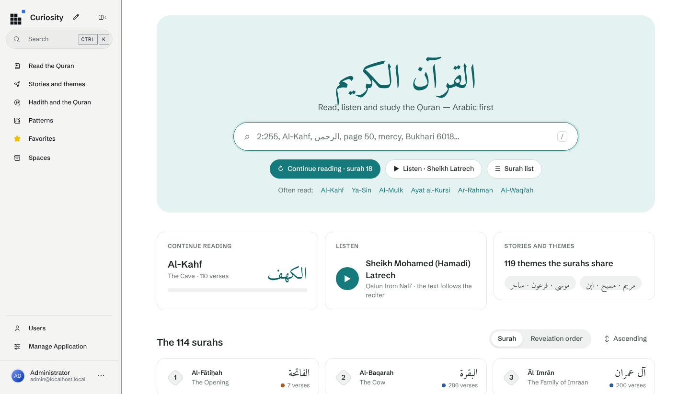
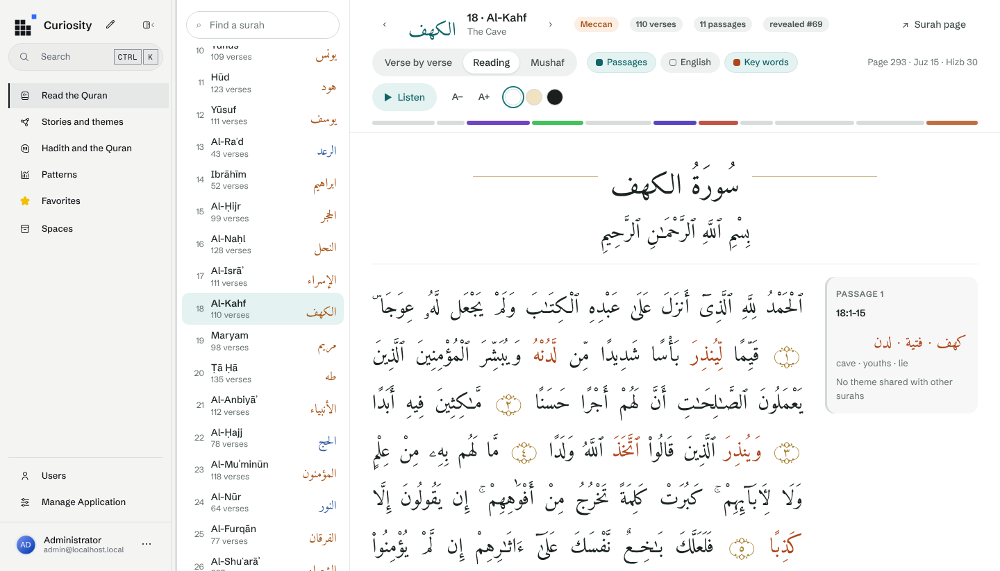
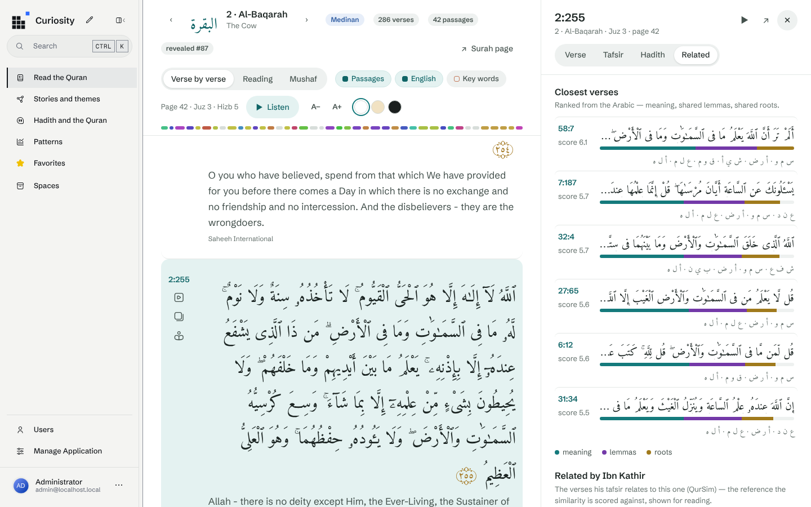
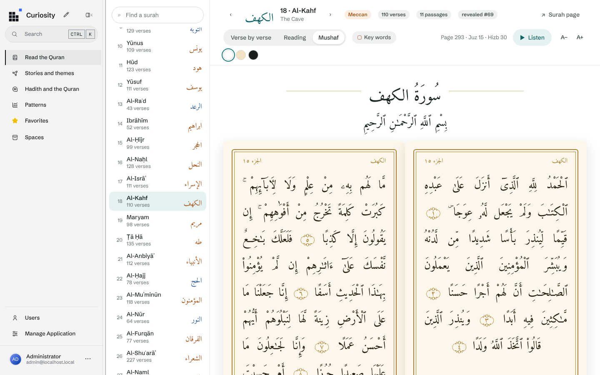
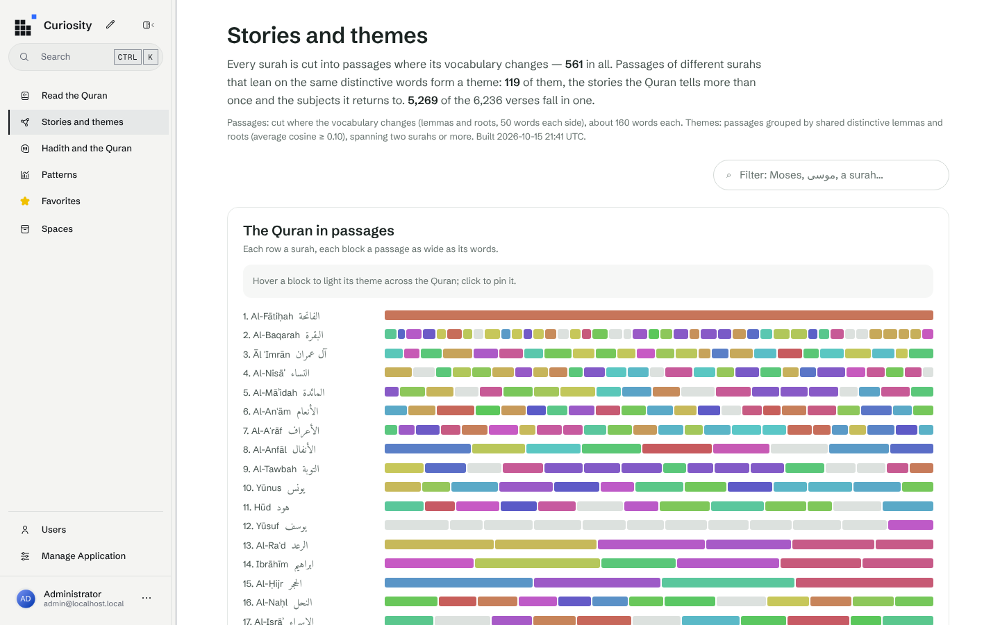
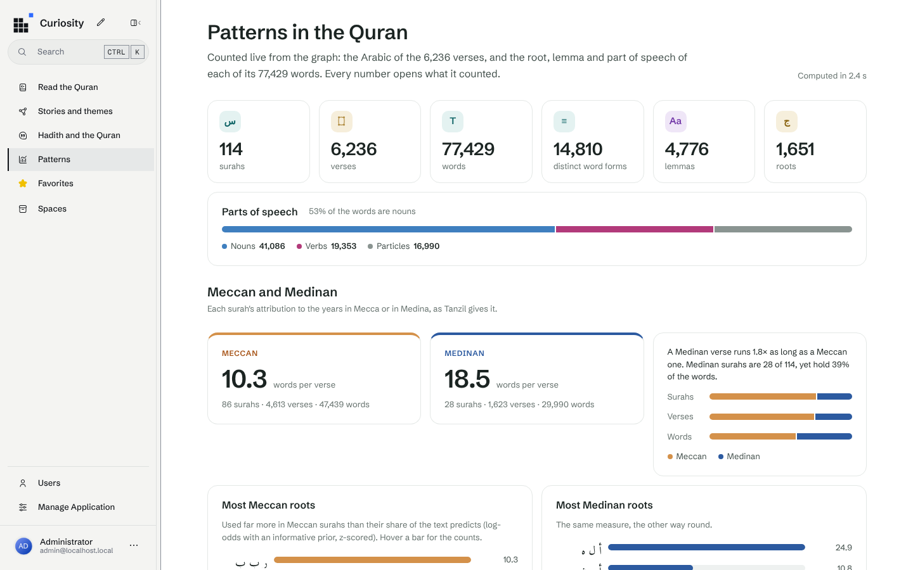

# Quran Knowledge Graph

The Quran as a knowledge graph — **Arabic first** — in a [Curiosity](https://curiosity.ai)
workspace: every surah, verse and word, each word with its root and lemma, a page of
patterns anyone can read, every surah cut into its passages, the stories and subjects several
surahs share, and similar verses and surahs — all computed from the Arabic and measured against
references made by people (Ibn Kathir's related verses, the traditional ruku' sections).



| | |
|---|---|
| **Graph** | 114 surahs · 6,236 verses · 77,429 words · 1,651 roots · 4,776 lemmas · 30 juz · 7,295 tafsir links · 4 tafsirs (32,409 entries): Ibn Ashur's al-Tahrir wa al-Tanwir, the main one, in Arabic; al-Mukhtasar, al-Jalalayn and Ibn Kathir in Arabic and English · Sahih al-Bukhari and Sahih Muslim (14,940 hadith, 2,385 links to the verses they quote) · Sheikh Mohamed Latrech's recitation (114 surahs, every verse timed) — ~147,500 nodes, ~541,800 edges |
| **Home** | one search box in the middle, answering as you type: a verse (`2:255`), a surah in any spelling (`kahf`, `الكهف`, `18`), a page or juz of the mushaf (`page 50`, `juz 30`), a hadith (`Bukhari 6018`), then the verses whose Arabic or English words match (`/` puts the cursor in it); then where you left off, the recitation, the themes, the 114 surahs by the order of the book or of revelation, and the text's numbers |
| **Patterns** (`#/patterns`) | totals and parts of speech; Meccan vs Medinan (length, characteristic roots); verse length in the book's order and in the order of revelation; most frequent roots, nouns, verbs; where each root lives across the juz and surahs; every surah in a table. Every count opens what it counted. |
| **Reading** | the **Quran View** (`#/read/2/255`): the 114 surahs, read three ways — **flowing** (continuous Arabic in its passages, no box per verse), **verse by verse** (a row each, its key and translation), or as the **mushaf's pages** (the 604 pages of the Madinah mushaf, two by two in a gold frame) — on a light, sepia or dark page, with the page, juz and hizb of where you are, and the English on demand; hovering a word gives its root, lemma and features; flowing, each passage is described in the margin; a click on a verse opens its translations, its **tafsir** — Ibn Ashur's *al-Tahrir wa al-Tanwir* first, then al-Mukhtasar, al-Jalalayn and Ibn Kathir in Arabic and English, words, passage and theme, closest verses and tafsir links. In the chat, every verse cited (`21:30`) opens the same way. A passage and a theme read the same way, the words that tie them marked |
| **Pages** | a surah read in order, its passages, its similar surahs and its lexical profile; a verse word by word (root, lemma, part of speech), its tafsir, its similar verses and its tafsir links; a root's distribution, lemmas and forms; a theme surah by surah; a passage verse by verse |
| **Hadith and the Quran** | Bukhari and Muslim in Arabic and English, read against the text: every verse a hadith's Arabic quotes (the editions' braces, runs of six words or more, whole short verses; shared phrases graded apart) — 1,137 hadith quote a verse, measured against the translators' citations (94% / 82% found); every hadith's closest verses by the meaning of the Arabic and its distinctive words ([`tools/hadith-benchmark`](tools/hadith-benchmark/README.md)); every verse's hadith. The **Hadith and the Quran** page, the hadith pages, a Hadith tab and section on every verse, and the assistant's Hadith tools, which argue how a hadith relates to a verse — quotes, agrees, explains, adds, or an apparent tension, with the readings that reconcile it |
| **Recitation** | Sheikh Mohamed (Hamadi) Latrech, Qalun from Nafi' — the reading of Tunisia's mosques: play a surah, or from any verse, and the text marks the verse being recited and keeps it in view; repeat a verse, change the speed. Qalun counts the verses the Madani way (6,214), so its verse marks are carried over to the text's 6,236 through a word alignment of the two texts — 6,156 exact, 80 estimated |
| **Passages and themes** | every surah cut where its vocabulary changes (561 passages); passages of different surahs that lean on the same distinctive words grouped into 119 themes — Moses and Pharaoh in 8 surahs, Lot in 7, Mary and the Messiah in 7… On the **Stories and themes** page — a map of the 114 surahs in their passages, coloured by theme — and in every surah's text. Built inside the workspace by `just clusters`, no model needed — scored with [`tools/cluster-benchmark`](tools/cluster-benchmark/README.md) |
| **Similarity** | verses: Arabic embedding (AraModernBert-STS, the best of 24 models measured) + shared lemmas + shared roots, each standardised and summed — scored against QurSim with [`tools/embedding-benchmark`](tools/embedding-benchmark/README.md). Surahs: shared distinctive lemmas and roots, and how many of each verse's nearest verses in meaning the other surah holds |
| **Models** | the verses' Arabic embedded by AraModernBert-STS on the Mac's GPU ([`tools/embedding-server`](tools/embedding-server/README.md)), or built in (Harrier, no setup); chat through any tool-calling model (Claude via a local OpenAI-compatible wrapper, or Ollama) — [docs/models.md](docs/models.md) |











## Run it on a Mac

```bash
brew install --cask docker dotnet-sdk && brew install just ollama
dotnet tool install --global Transpose.Compiler && dotnet tool install --global Curiosity.CLI
just setup && just bootstrap          # ~15 minutes the first time
open http://localhost:8080            # admin / admin (from .env)
```

The full runbook — Docker settings, local models, troubleshooting — is
[docs/local-setup.md](docs/local-setup.md). `just` on its own lists every task.

## Layout

```
data/manifest.json          the sources, with checksums — `just fetch` downloads them to data/raw/
src/
  QuranKG.Dataset/          reads, cleans and joins the sources; the corpus model   (+ .Tests)
  QuranKG.Tools/            fetch, check-data, sync-dto — no workspace needed
  QuranKG.Connector/        the graph schema and the ingest (Curiosity.Library)
  QuranKG.Definitions/      the workspace as files: indexes, styles, settings, endpoints
  QuranKG.FrontEnd/         the home page, the reader and every page (C# → JavaScript, Tesserae)
  QuranKG.Workspace/        tokens, status, endpoint calls, the clusters build, the embeddings switch
tools/embedding-benchmark/  which model reads Quranic Arabic best, measured on QurSim
tools/embedding-server/     that model (AraModernBert-STS) behind the OpenAI embeddings API, for the workspace
tools/cluster-benchmark/    the passages, themes and similar surahs, measured on the ruku' and QurSim
scripts/                    every task, as .sh and .ps1 — called by the Justfile
docs/                       use case, data sources, graph model, models, local setup
.claude/skills/             how to build on Curiosity, and on this corpus
```

## Docs

- [Use case](docs/use-case.md) — what it is for, the questions it answers, its principles
- [Data sources](docs/data-sources.md) — what each source gives, licences, cleaning rules, what to add next
- [Graph model](docs/graph-model.md) — nodes, edges, and why it is shaped this way
- [Models](docs/models.md) — embeddings and chat models, what to download, memory budget
- [Local setup](docs/local-setup.md) — the Mac runbook
- [TODO](TODO.md) — what is next: the large models on the Mac, topics, the assistant

## Attribution

Quran text and metadata: [Tanzil](https://tanzil.net) (CC BY 3.0). Morphology: the
[Quranic Arabic Corpus](https://corpus.quran.com) (GNU GPL). Translations: Saheeh International
and Ali Quli Qara'i via Tanzil. Related verses: QurSim (Sharaf & Atwell, LREC 2012). Hadith: Sahih al-Bukhari (English: Muhsin Khan)
and Sahih Muslim (English: Abdul Hamid Siddiqui) from [hadith-api](https://github.com/fawazahmed0/hadith-api),
the books' Arabic names from [hadith-json](https://github.com/AhmedBaset/hadith-json). Tafsir: Muhammad al-Tahir ibn Ashur's *al-Tahrir wa al-Tanwir*, al-Mukhtasar (Tafsir Center for Quranic
Studies), al-Jalalayn (English: Feras Hamza, Royal Aal al-Bayt Institute) and Ibn Kathir (English
abridgement: Darussalam), from [QUL](https://qul.tarteel.ai). Recitation: Sheikh Mohamed Latrech, audio and
verse timings from [qaloun.app](https://qaloun.app) (streamed, not copied); the Qalun text and its verse numbering from the King Fahd
Glorious Quran Printing Complex. Details and
licences in [docs/data-sources.md](docs/data-sources.md).
