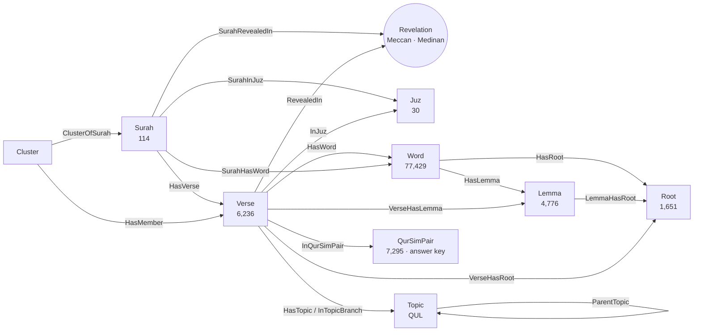

# The graph model

Ten node types, written by [`src/QuranKG.Connector`](../src/QuranKG.Connector) from the sources in
[data-sources.md](data-sources.md). The connector's schema (`Schema.cs`, `Edges.cs`) is the
contract for everything above it: `just emit-schema` generates the `N`/`E` constants the front end
uses, and the workspace injects the same constants into every endpoint.

Every edge has a reverse (`InSurah`, `RootOfWord`, `LemmaInVerse`, …) with its own name, so a
traversal reads in the direction it goes.

| Node | Key | What it holds |
|---|---|---|
| **Surah** | `1`…`114` | names (Arabic, scholarly, Latin, English), revelation place and order, verse and ruku' counts |
| **Verse** | `surah:ayah` | **the Arabic** — Uthmani (display) and Simple-Clean (search, embeddings) — then transliteration, two English glosses, and its place: juz, hizb, rub', manzil, ruku', page, sajda |
| **Word** | `surah:ayah:position` | one occurrence: the form with and without diacritics, its segments and their tags, part of speech, features, verb form, root and lemma |
| **Root** | its letters (`رحم`) | the family a word is built on; `Spaced` (`ر ح م`) for display |
| **Lemma** | `lemma|root|tag` | a dictionary headword (13 spellings belong to two different words, hence the composite key) |
| **Juz** | `1`…`30` | the thirtieths, with the verse each starts at |
| **Revelation** | `Meccan` / `Medinan` | where a surah was revealed |
| **Topic** | QUL id | a theme, with its parent; verses link to their topic and every ancestor of it |
| **QurSimPair** | `a~b` | two verses Ibn Kathir relates, with the degree (0–2). **The answer key** |
| **Cluster** | per run | a group of verses found by clustering — the whole Quran's stories, or one surah's passages. Empty until the Clusters work runs |

## Why it is shaped this way

- **Arabic first.** The verse's Arabic is its text; translations are reading aids and never a
  similarity signal. Search ignores diacritics and hamza forms, so a reader can type Arabic with or
  without tashkeel.
- **Location at every level.** A word links to its verse *and* its surah; a verse to its surah,
  juz and revelation place. A facet or a shared-neighbour signal only sees direct neighbours, so a
  fact needed at a level is an edge at that level.
- **Roots and lemmas at the verse level too.** `VerseHasRoot` / `VerseHasLemma` repeat the words'
  facts one level up, distinct per verse: "verses that share a rare root" and "verses with root X"
  are then one hop, which is what makes the similarity endpoint and the root pages fast.
- **Words are nodes.** 77,429 of them: every count on the dashboard ("most frequent roots", parts
  of speech, words per verse) is computed live from them, and each count can open what it counted.
- **The answer keys are in the graph but out of the AI's reach** (see data-sources.md).
- **Clusters are written inside the workspace, not by the connector**, because they are derived:
  they depend on the embedding model and the method, and are re-run as those improve.
